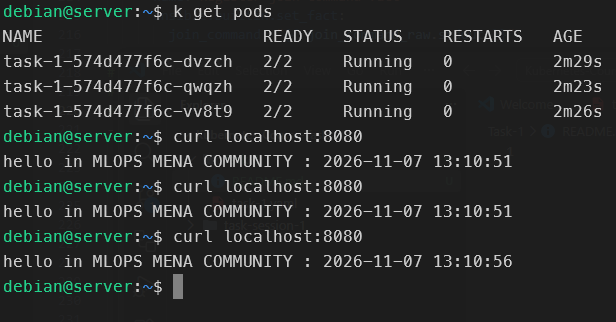
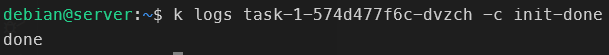
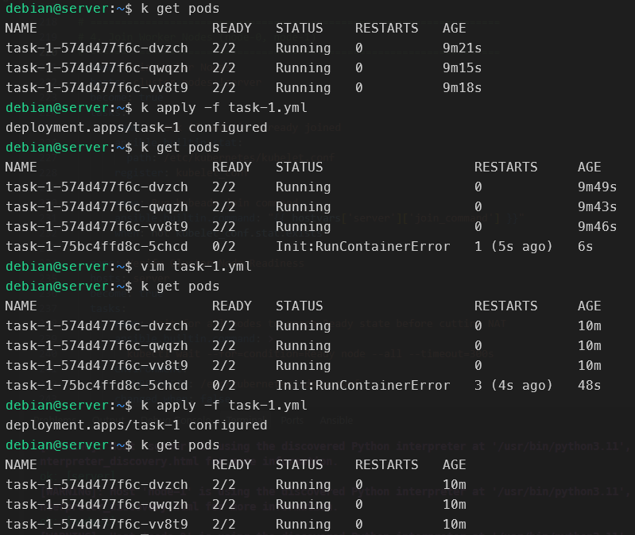

# Task-1: Nginx "Hello" Page with a Timestamp Sidecar on Minikube

A 3-replica Deployment on a 3-node Minikube cluster. Each Pod serves a page that shows the current timestamp:

```text
hello in MLOPS MENA COMMUNITY : 2026-11-07 13:10:51
```

## Pod architecture

All containers share one process namespace (`shareProcessNamespace: true`) and no volumes are used.

| Container | Type | Role |
|-----------|------|------|
| `init-done` | Init container | Prints `done` and exits. The other containers start only if it succeeds. |
| `time-updater` | Sidecar (init container with `restartPolicy: Always`) | Finds the nginx PID with `pgrep` and rewrites `index.html` every 5 seconds through `/proc/<pid>/root/usr/share/nginx/html/index.html`. |
| `nginx` | Main container | Serves `index.html` on port `80`. |

How it works:

- Because the PID namespace is shared, the sidecar can see nginx's process. `/proc/<pid>/root` exposes nginx's root filesystem, so the sidecar can write into it without a shared volume.
- The sidecar is declared under `initContainers` with `restartPolicy: Always` (a native sidecar, Kubernetes 1.28+). This gives the startup order `init-done` → `time-updater` → `nginx`, and the sidecar keeps running for the life of the Pod.
- That is why `READY` shows **2/2**: `time-updater` and `nginx`. `init-done` has already completed.

Manifest: [`task-1.yml`](./task-1.yml)

---

## Screenshots

### 1. Running Pods and timestamp updates



```bash
kubectl get pods
curl localhost:8080
```

**Pods**

- Three Pods from the same ReplicaSet (`task-1-574d477f6c-*`) are all `2/2 Running` with `0` restarts.
- The ages are about 2m23s to 2m29s, so they started together.

**Timestamps**

- Three `curl` calls against `localhost:8080` return:

| Call | Response timestamp |
|------|--------------------|
| 1 | `13:10:51` |
| 2 | `13:10:51` |
| 3 | `13:10:56` |

- Calls 1 and 2 fall in the same 5-second window and return the same value. Call 3 returns a value exactly 5 seconds later.
- This confirms the sidecar updates `index.html` every 5 seconds and nginx serves the new content.

### 2. Init container output



```bash
kubectl logs task-1-574d477f6c-dvzch -c init-done
```

The output is `done`, so `init-done` ran its command and exited with code `0`. Kubernetes then started the sidecar and nginx.

### 3. Forced init failure, zero downtime and recovery



This screenshot shows three steps.

**Step 1: baseline**

- Three healthy Pods (`task-1-574d477f6c-*`), each about 9m old.

**Step 2: apply a broken `init-done`**

- `init-done` was edited to fail, then `kubectl apply -f task-1.yml` returned `deployment.apps/task-1 configured`.
- The Deployment created a new ReplicaSet (`task-1-75bc4ffd8c`) and one new Pod, `task-1-75bc4ffd8c-5chcd`.
- That Pod is stuck at `0/2` with status `Init:RunContainerError`.
- Its restart count rises from `1` to `3` in under a minute, so Kubernetes keeps retrying the init container with growing back-off.

**Step 3: fix and re-apply**

- The manifest was fixed with `vim task-1.yml`, then re-applied (`deployment.apps/task-1 configured`).
- The three original Pods were `2/2 Running` with `0` restarts throughout, with ages unchanged (9m → 10m).
- Production traffic was never interrupted.